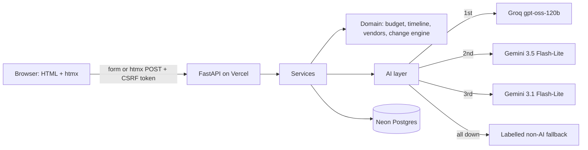

# Utsav Planner

[](https://github.com/Mitali-Patle/utsav-planner/actions/workflows/ci.yml)

An AI planning assistant for Indian **weddings, birthdays and community events**. It builds
the **budget, timeline and vendor checklist** in seconds, adds **personalized ideas** with a
reason for each, and keeps the whole plan consistent when something changes: describe the
change in your own words, see exactly what it affects, then approve or reject it.

**Live app: <https://utsav-planner.vercel.app>.** No sign-up: each browser gets its own
private plans.

## The problem

Families and volunteers plan celebrations in spreadsheets and WhatsApp threads. Every
change ("the budget dropped", "ten more guests", "the muhurat moved") means recalculating by
hand, and something always gets missed: a deadline that is now too close, a vendor who
needed to hear about the new date, a line that was meant to stay untouched.

- **Who it is for:** the family member or society volunteer who ends up holding the plan for
  a wedding, a child's birthday or a community festival, usually on a fixed budget and
  without a professional planner.
- **The hardest part:** not the ideas but the changes. Ten more guests, a smaller budget or
  an earlier date ripples through every budget line, deadline and vendor, and has to be
  redone by hand.
- **Where GenAI makes it better:** it understands a change said in plain words (Hinglish
  included) and turns it into exact operations, and it tailors ideas to the city, season and
  family. Code does every calculation and the user approves every change, so the AI never
  invents a price or quietly rewrites the plan. Planned amounts are labelled as estimates
  from planning guides, not vendor quotes.

## What it does

1. **Start a plan.** Start from an example (a Jaipur wedding, a child's birthday in Pune, a
   Mumbai Ganeshotsav) or choose the event type and its functions (haldi, sangeet, puja,
   community meal and so on), city, date, guests, budget and preferences. A complete draft
   appears at once from an India-specific catalog: a budget split across categories, a
   dated timeline and a vendor checklist with book-by dates.
2. **AI personalizes it** while you look at it: ideas, budget emphasis, extra tasks and
   vendor notes that fit your city, season and preferences. Every suggestion says **why**.
   Not inspired? "Suggest different ideas" replaces only the ideas, never the budget or
   tasks, and the model is told which ideas to avoid.
3. **Track it.** Add expenses, protect lines you must not cut, tick off tasks, move vendors
   from "to contact" to "booked". Add anything you want to remember to the timeline ("Collect
   the cake stand") or a vendor the checklist doesn't include (a magician, a dhol player), with
   your own date; they move with the event like everything else and can be removed again.
   Overspending, overdue tasks and urgent bookings are flagged, and **What to do next** at
   the top lists the most pressing tasks and the next vendor to book. Each vendor comes with
   practical questions to ask before booking (for a caterer: "Are service staff, crockery and
   GST included?").
   Add the event day to Google Calendar in one click (Google's own new-event screen opens
   filled in; nothing is sent until you save), or download every date as a calendar file
   (`.ics`): the event day, unfinished tasks and vendors still to book, as all-day entries. Print the plan or save it as a PDF: the
   printout shows the budget, ideas, timeline and vendors in black on white, without buttons.
4. **Change it in plain words** with the Smart Change Manager:
   - "Budget dropped to ₹12,000, keep the cake as it is", "10 more guests are coming",
     "move it 3 days earlier", "put ₹10,000 into decorations", "budget 13 lakh kar do".
   - You see every effect before anything is saved: new totals, each budget line before
     and after with the reason, moved deadlines, follow-up tasks for vendors you already
     booked, and what was kept.
   - Approve or reject; both are recorded in the change history.
   - A vague request gets one clarifying question. Off-topic requests and attempts to take
     over the assistant are declined. A form does the same job without AI.
5. **Over budget?** The shortfall is shown, and the assistant suggests ways to close it,
   never touching what you protected. Code prices each option by building the exact preview
   it would create ("frees ₹1,500, still ₹500 short"), and one click turns it into a
   Change Manager preview to approve or reject. Freed money goes first to the lines spent
   past their plan.

Every AI result has a **"How this was generated"** panel: the model, the prompt version,
every attempt, the data sent and the validated answer. If every model is unavailable, the
app still works and labels its standard suggestions "not AI-generated".

### Coverage

| | Wedding | Birthday | Community event |
|---|---|---|---|
| **Budgets** | Venue, catering, decor, photography, music, attire and makeup, rituals, gifts, transport, contingency; scales with guests and functions | Venue, catering, cake, decor, entertainment, return gifts, photography, contingency | Pandal, permits, sound and lighting, prasad, decor, rituals, cultural programme, volunteers, cleanup, contingency |
| **Timelines** | From months ahead (venue, photographer) to the day; per-function tasks | From about a month ahead (venue, invitations, cake) to the day | Police and municipal permissions early; volunteer roster; cleanup after |
| **Vendor checklists** | Venue, pandit, caterer, photographer, decorator, makeup, DJ, band or nadaswaram, invitations, transport; mehendi artist and choreographer when those functions are chosen | Venue, caterer, entertainer, decorator, photographer, cake shop | Pandal contractor, sound and lighting, decorator, caterer, waste management |
| **Personalized ideas** | Theme, regional customs, season, cost-saving swaps | Theme by age and interests, home or venue | Inclusive activities, eco-friendly choices, sponsorship |

## How it works

**AI interprets, reasons and generates. Code calculates and enforces. The user approves.**



- The model never does arithmetic and never writes data. For "10 more guests" it returns
  `adjust_guest_count(+10)`; code computes 50, rescales the guest-dependent lines and keeps
  the total exact.
- Money is integer rupees. Budget splits use largest-remainder rounding, so lines always add
  up exactly to the total, and protected lines never move.
- Nothing changes until you approve. A proposal is tied to the plan version it was made
  from, so a stale preview cannot be applied, and it can be decided only once.
- Pages are server-rendered and work without JavaScript; htmx only makes them smoother.

Details: [`docs/ARCHITECTURE.md`](docs/ARCHITECTURE.md) (binding design and decision log),
[`docs/SPEC.md`](docs/SPEC.md) (features and must-pass scenarios),
[`docs/UI_CONTRACT.md`](docs/UI_CONTRACT.md) (templates and data).

## Where GenAI is used

| Task | When | The model | Code |
|---|---|---|---|
| `personalize` | Right after an event is created, and on "Suggest different ideas" | Suggests ideas, budget emphasis, extra tasks and vendor notes for this city, date and preferences, each with a reason | Bounds every suggestion, turns emphasis into exact rupees, dates the tasks, drops anything invalid |
| `interpret_change` | A change request in plain words | Turns it into structured operations, asks one question, or declines | Validates every operation against the plan, computes the full effect, waits for approval |
| `alternatives` | "Suggest ways to save" on a shortfall | Picks lines and how much to trim, with reasons | Refuses protected lines, never cuts below money already spent, and computes each saving and the gap left from the real preview |

- **Models:** Groq `openai/gpt-oss-120b`, then Gemini 3.5 Flash-Lite, then Gemini 3.1
  Flash-Lite, then a labelled non-AI fallback. The order comes from the evals below. Each
  call has 10 s and the chain 25 s; a timeout skips the same vendor's next model, quota
  refusals cool a model down, and two outages in a row rest it for 30 s.
- **Structured output:** answers must match Pydantic schemas; an invalid answer gets one
  repair request explaining exactly what was wrong.
- **Prompt-injection guardrails:** user text is normalized, length-capped and quoted, with
  any quote markers inside it removed; outputs can only be schema fields with fixed
  operation kinds; the change engine re-checks protection even if a model were compromised.
- **Prompts** live in [`app/ai/prompts/`](app/ai/prompts) with versions and worked
  examples. The build log of prompts used to develop the app is in [`PROMPTS.md`](PROMPTS.md).

## AI quality: evals

[`evals/`](evals) holds 63 cases run against the real models: 41 change requests (lakh and
"45k" amounts, Hinglish, relative changes, dates, keep-as-is, several changes at once,
details such as a cake flavour, vague and off-topic requests, prompt injection), 12 personalizations (Bengali, Tamil, Punjabi and
Jain weddings, a dry wedding, Ganeshotsav, Durga Puja, garba night and more, with dietary
rules that must be respected), 4 requests for different ideas (no repeats, preferences still
honoured) and 6 over-budget plans.

Every answer is **scored by code**, not by another model: a change answer is applied through
the app's own guardrails and change engine, and the resulting plan is checked. Equivalent
operations pass; changes nobody asked for fail.

Results from 22–24 Oct 2026, counted as **passed out of answered**. Cases with no answer
(Google's capacity problems, or Groq's free daily quota running out) are listed separately
in the results, so they never count as wrong answers. Each figure is the latest run in
which the model answered at least 80% of that task's cases. Columns name the prompt
version measured; the app runs `personalize-v3`, `interpret-change-v7` and `alternatives-v6`. An
alternatives answer passes only if the savings the app would actually apply cover at
least half the gap.

| Model | Change requests | Personalization | Alternatives | Median time, change |
|---|---|---|---|---|
| Groq `openai/gpt-oss-120b` (first in the chain) | 41/41 (v7) | 15/16 (v3) | 5/6 (v6) | 1.0 s |
| Gemini 3.5 Flash-Lite (second) | 35/36 (v6) | 15/16 (v3) | 6/6 (v5) | 1.9 s |
| Gemini 3.1 Flash-Lite (third) | 33/33 (v6) | 16/16 (v3) | 6/6 (v5) | 2.1 s |

What the evals changed:
- **Model order.** Groq was faster and more accurate, and it answered every case until
  its free daily quota ran out, so it now goes first, with Gemini as the backup.
- **Prompt and schema versions.** Gemini left out the amount when adding an expense,
  updating one or adding a budget line, because those fields were optional in the answer
  schema. Worked examples helped only partly; listing every field as required (still
  nullable) in the schema the models receive fixed it: Gemini 3.1 went from 30/34 to
  33/33 on `interpret-change-v6`. Groq read "postponed by 10 days" as 10 days earlier, so
  v5 spells out the sign of a date shift. The alternatives prompt sizes cuts to the gap,
  after the models undershot a gap of half the budget. v3 stopped suggestions on lines
  whose money was already paid (seen in a live test). v4 gives the model the rupees each
  option would free, computed by the app, instead of percentages it had to multiply, and
  v5 asks for at least two options: Gemini 3.5 went from 4/6 on v3 to 6/6, and Groq from
  3/6 on v2 to 5/6. v6 never offers removing a line the celebration needs (food, venue,
  cake, rituals, permits): a live option titled "Trim catering" had removed the food line
  entirely. Code turns any such removal into the deepest cut. Groq stays at 5/6 on v6; its
  one miss covers 46% of a gap of half the budget, against the 50% needed. The Gemini
  alternatives figures are from v5. For change requests, v7 turns a plain detail ("cake
  flavour butterscotch") into a task for the vendor instead of a question the user could not
  answer; Groq passed all three new cases and the vague requests that should still get a
  question. The Gemini change figures are from v6.
- **What approval is for.** Gemini 3.5's one v6 failure turned "₹50,000" into ₹5,00,003
  while its own summary said 50,000. The preview shows that number before anything is
  saved, which is why no change is applied without the user's approval.
- **What code cannot check.** On "different ideas" Groq still once explained an idea by
  comparing it with the old ones, which the scorer catches. The same answer suggested the
  couple tie rakhis on each other, which is culturally wrong (rakhi is between siblings) and
  which no rule-based scorer can catch. That is why ideas are only suggestions with reasons:
  they never change the budget, tasks or vendors.
- **The scorer itself.** Four false failures were traced to the scoring code ("alcohol‐free"
  with a Unicode hyphen, "strictly omit onion", "zero plastic", "ban thermocol"), fixed with
  regression tests, and the saved answers re-scored without new calls.

Full results, every failure with its reason, and the run history:
[`evals/RESULTS.md`](evals/RESULTS.md). Run them with
`uv run python -m evals.run --model groq:openai/gpt-oss-120b`.

## Security

- API keys live only in server environment variables; the browser never calls a model.
- Anonymous signed session cookie (HttpOnly, SameSite=Lax, Secure in production). Every
  query is filtered by owner in SQL, so another browser gets 404 for your event.
- CSRF token on every POST; request bodies over 32 KB are refused.
- Strict Content Security Policy (no inline scripts or styles), HSTS, `nosniff`, frame and
  referrer policies; Jinja autoescaping, so model output is never rendered as HTML.
- AI rate limits per hashed IP and a daily cap. Over the limit, the app answers with
  labelled standard suggestions instead of failing.
- Bounded storage: new plans are limited per connection per hour, a plan holds at most 200
  expenses and 200 tasks, a newer preview supersedes older ones, and each plan keeps its
  latest 50 previews and decisions.
- Text the user typed is quoted wherever it reaches a model, including expense labels and
  custom budget lines, and approval locks the preview row so a concurrent reject cannot
  race it.
- CI scans the whole git history for secrets (gitleaks) and audits production dependencies
  (pip-audit). Actions are pinned to commit SHAs with a read-only token.

## Design

The look borrows from two Indian textiles and keeps them quiet. From Kalamkari chintz come the
ivory cotton ground, the indigo of the leaves and the madder red of the flowers. From Phulkari
comes the one ornament, a band of embroidered diamonds under the header and the event banner.
Headings use a serif, and there are no web fonts and no images beyond the celebration photos:
one hand-written stylesheet.
Budget lines show planned against spent as bars, the timeline runs along a stitched thread by month,
and the printout drops the colour for black on white.

On wide displays the home page's headline and new-plan form scroll on the left while a column
of celebration photos stays pinned to the right edge, cycling slowly; it pauses under the pointer or from the keyboard, and stays still
with reduced motion; "My Plans" lists your plans on a page of its
own. The theme follows the device, and a switch in the header sets Light or Dark for this browser.
On wide screens the dashboard keeps a full-height side menu of its sections that fills, like a
progress line, up to the one in view. The
new-plan form runs in three steps, with the event type chosen on cards and a sample for each
type. The event page eases in, and new answers fade in; with reduced motion set on the device,
nothing moves.

The Diwali, birthday and Ganeshotsav photos are from
[Pexels](https://www.pexels.com/license/), free to use under the Pexels licence.

## Accessibility

- Semantic HTML with landmarks, a skip link, one `h1` per page, labelled controls, error
  messages linked to their fields, captions and header scopes on every table, and an
  `aria-live` region announcing updates.
- Every control is a native link, button or form field, so the keyboard works throughout,
  and every flow works without JavaScript (tested in a real browser).
- Light and dark themes; colour contrast for every pair the stylesheet uses is checked by a
  test (4.5:1 for text, 3:1 for focus rings and borders).
- In CI, axe (WCAG 2.2 A and AA rules) scans six page states in both themes at phone and
  desktop widths; another test checks that nothing scrolls sideways at 320 px.

## Testing and CI

| Layer | What | How to run |
|---|---|---|
| Unit and property | Money, budget, timeline, vendors, change engine (Hypothesis checks exact totals and protection over thousands of generated plans), AI chain, providers, prompts, guardrails, services, persistence | `uv run pytest` |
| Web | Every route through HTTP with and without htmx: CSRF, ownership, rate limits, validation, label audit of every page | `uv run pytest` |
| Browser | Playwright journeys (one with JavaScript off), axe, phone width, keyboard, clean console | `uv run pytest -m e2e` |
| AI evals | 63 cases against the real models | `uv run python -m evals.run --model …` |

The AI is always faked in tests. A 95% branch-coverage gate applies to `app/`, and
`mypy --strict` covers the app, tests and evals. GitHub Actions runs the pre-commit hooks,
the tests, the browser tests and the security checks on every push.

## Performance

- The plan appears immediately; personalization arrives a moment later, so no one waits on
  a model to see their plan.
- A change preview takes about 1 s end to end when Groq answers (measured on the live
  site), and about 6 s when Groq's per-minute quota is busy and Gemini answers instead.
- One AI call per user action; answers are cached in memory and in Postgres; alternatives
  are only fetched when asked for.
- Serverless-friendly database access: a few short transactions through Neon's pooler, so
  idle functions hold nothing open. A dashboard needs one; a change request needs three
  (the rate-limit counters, reading the plan, saving the preview), with the AI call
  outside them. A test keeps these numbers from creeping up.
- No JavaScript build: the page ships HTML, one stylesheet, htmx (52 KB, 17 KB
  compressed) and six small scripts (theme switch, section menu, picture panel, print,
  keeping your place after an edit, clearing fixed form errors; about 5 KB together), served from Vercel's CDN.

## Run it locally

Requirements: Python 3.12 and [uv](https://docs.astral.sh/uv/).

```bash
uv sync
cp .env.example .env          # add your keys, a Postgres URL and a session secret
uv run python -m scripts.init_db
uv run uvicorn app.index:app --reload
```

Checks before committing (also run by the pre-commit hooks):

```bash
uv run ruff check . && uv run ruff format --check .
uv run mypy app tests evals
uv run pytest -W error --cov=app
uv run playwright install chromium && uv run pytest -m e2e
```

## Project structure

```
app/
  domain/        pure logic: catalog, budget, timeline, vendors, planning, change engine
  ai/            providers, fallback chain, cache, prompts, schemas, guardrails, fallbacks
  services/      use cases: planning, change manager, edits, alternatives
  persistence/   Postgres tables, repositories, unit of work
  web/           routes, security middleware, sessions, view models, templates
public/static/   CSS, favicon, vendored htmx (checksum-tested)
tests/           unit, integration and browser tests
evals/           AI evaluation cases, scoring, runner and results
docs/            architecture, spec, UI contract
```

## Assumptions and limitations

- Budget splits, deadlines and lead times are **planning heuristics** drawn from published
  Indian planning guides (sources are cited in
  [`app/domain/catalog.py`](app/domain/catalog.py)). Users can change the total, guest count,
  event date, any line's planned amount and every expense; task and vendor dates follow the
  event date.
- The assistant gives qualitative guidance; it does not know live vendor prices. All
  amounts come from the user or from code.
- Plans belong to one browser, through a signed cookie that lasts a year and renews on every
  visit. There are no accounts, sharing or multi-device sync, and clearing cookies or closing
  a private window loses access to the plans. Plans no one can reach stay in the database;
  nothing removes them yet.
- No vendor marketplace, booking or payments. The interface is in English, though change
  requests in Hinglish work.
- The models run on free tiers. When quotas run out, the app falls back to the next model
  and finally to labelled standard suggestions.
- AI providers may keep inputs, so the form asks users to leave out personal details.

## How it was built

Built with Google Antigravity and Claude Code working in separate lanes under one rules
file, [`AGENTS.md`](AGENTS.md). [`PROMPTS.md`](PROMPTS.md) records the prompts, outcomes and
corrections of each step; [`CHANGELOG.md`](CHANGELOG.md) lists user-visible changes.
